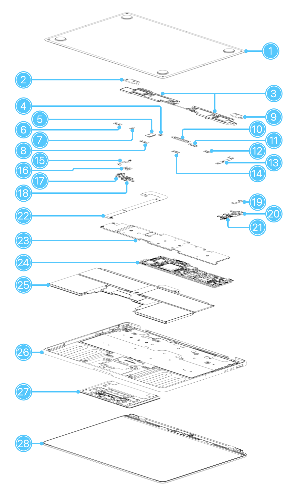

# Lab 3 — Teardown, and the same machine from the command line

Pair: worked alone                    Driver first half: —
Machine: MacBook Air (M2, 2022), Mac14,2 (host, macOS); guests: Debian 13 arm64 and Windows 11 arm64 in VMware Fusion
Date: 29.10.2026

## What I did

1. Found the exact model on the host (macOS Terminal, not a VM):

~~~
system_profiler SPHardwareDataType
system_profiler SPDisplaysDataType | grep Cores
~~~
~~~
Model Identifier: Mac14,2
Chip: Apple M2
Memory: 8 GB
Total Number of Cores: 10
~~~

2. Downloaded the exploded view from the Apple repair manual:

~~~
curl -o evidence/manual-figures/exploded-view.png https://cdsassets.apple.com/live/SZLF0YNV/service-documentation/ssr/mba-m2-2022-j413/100604-ev/TP2132_EV_880.png
~~~

3. Saved host output as text, serial numbers replaced with XXXX:

~~~
HIDE='s/(Serial Number[^:]*|Hardware UUID|Provisioning UDID): .*/\1: XXXX/'
system_profiler SPHardwareDataType | sed -E "$HIDE" > macos-specs.txt
sysctl hw.physicalcpu hw.logicalcpu hw.memsize >> macos-specs.txt
system_profiler SPMemoryDataType | sed -E "$HIDE" >> macos-specs.txt
system_profiler SPNVMeDataType | sed -E "$HIDE" >> macos-specs.txt
diskutil info disk0 >> macos-specs.txt
~~~

4. Debian guest: connected from the host with `ssh`, ran the commands, copied the file back with `scp`:

~~~
lscpu > linux-specs.txt
free -h >> linux-specs.txt
sudo dmidecode -t memory 2>&1 | sed -E "$HIDE" >> linux-specs.txt
lsblk -d -o NAME,MODEL,SIZE,ROTA,TRAN >> linux-specs.txt
sudo dmidecode -t baseboard 2>&1 | sed -E "$HIDE" >> linux-specs.txt
~~~

5. Windows guest: PowerShell transcript, serial numbers replaced, file copied to the host through the clipboard:

~~~
Start-Transcript -Path windows-specs.txt; Get-CimInstance Win32_Processor | Format-List *; Get-CimInstance Win32_ComputerSystem | Format-List *; Get-CimInstance Win32_PhysicalMemory | Format-List *; Get-PhysicalDisk | Format-List *; Get-CimInstance Win32_BaseBoard | Format-List *; Stop-Transcript
Get-Content windows-specs.txt -Raw | Set-Clipboard
~~~

## Result

All Part A facts were read on the **host** (macOS on the real laptop), not inside a VM.

### 1. The machine

| Field | Value | Source |
|---|---|---|
| Manufacturer | Apple | `system_profiler SPHardwareDataType` |
| Model | MacBook Air (M2, 2022), 13-inch | Model Identifier `Mac14,2` |
| Model Number | MLY23LL/A | `system_profiler SPHardwareDataType` |
| Chip | Apple M2: 8-core CPU (4 performance + 4 efficiency), 10-core GPU | `SPHardwareDataType`, `SPDisplaysDataType` |
| Memory / storage | 8 GB / 512 GB | `SPHardwareDataType`, `SPNVMeDataType` |
| Logic board part | 661-25636 (M2, 10-core GPU, 8 GB, 512 GB) | Manual: Exploded View and Orderable Parts |

**How I found it:** I ran `system_profiler SPHardwareDataType` on the host. "MacBook Air" alone is not a model: the Model Identifier `Mac14,2` pins it to MacBook Air (M2, 2022), and `SPDisplaysDataType` showed the 10-core GPU, which picks my exact logic board in the parts list.

**Service manual:** [MacBook Air (M2, 2022) Repair Manual](https://support.apple.com/100603), Apple Self Service Repair, Manual ID PTGVKD. Figure and parts list: [Exploded View and Orderable Parts](https://support.apple.com/100604).

Evidence: [`evidence/macos-specs.txt`](evidence/macos-specs.txt). Serial numbers and UUIDs replaced with `XXXX`.

### 2. Components

*Figure 1. Exploded view from Apple's repair manual. The numbers are Apple's. Connections and limits come from the Procedures chapter of the same manual.*

| # | What | Connects to | Limits |
|---|---|---|---|
| 24 | Logic board: M2 SoC, 8 GB LPDDR5 and 512 GB storage on one board; sold only whole (661-25636) | Nine flex cables, the battery flex cable and two antenna coaxial cables; heat sink (23) on top (Logic Board procedure) | Memory, storage and CPU cannot be changed separately. A new board needs a new heat sink and a new Touch ID board |
| 23 | Heat sink: passive metal plate over the M2 chip, with thermal gel; no fan in the parts list | Clipped and screwed onto the logic board (Heat Sink procedure) | Cannot be reused once removed. No fan, so long heavy loads are limited by heat |
| 25 | Battery in a tray (661-26150) | Battery flex cable to the logic board; disconnected right after the bottom case comes off (Bottom Case procedure) | Held by adhesive tabs; replacing it needs new adhesive and a press (Battery procedure) |
| 28 | Display assembly, including the camera | Display and camera flex cables to the logic board; hinges screwed to the top case (Display procedure) | Sold only as a whole. A new display needs a new lid angle sensor |
| 15 | Lid angle sensor: tells the Mac how far the lid is open | Flex cable to a connector on the audio board (Audio Board procedure) | Paired with the display; after replacement, sleep and wake may fail until Repair Assistant is run |
| 26 | Top case: the frame everything mounts into; keyboard, keyboard backlight, microphones and interposer board are built in | Keyboard reaches the logic board through the interposer board flex cable (Top Case with Keyboard procedure) | Keyboard cannot be replaced on its own, only single keys or the whole top case |
| 27, 22 | Trackpad and trackpad flex cable | Trackpad flex cable to the logic board under a connector cowling (Trackpad procedure) | Flex cable is held by strong adhesive; shims come only with a new trackpad |
| 20 | MagSafe 3 board: the charging port | Its flex cable to the logic board; held in place by the wedge (19) | Charging only; if its flex cable is damaged, the whole board is replaced |
| 21 | USB-C boards: two separate boards, one port each | Each has its own flex cable to the logic board (USB-C Boards procedure) | A broken port means a new small board, not a new logic board |
| 17 | Audio board (headphone jack) | Audio board flex cable to the logic board; the lid angle sensor plugs into it (Audio Board procedure) | Only the jack; the speakers are separate parts (3) |
| 18 | Touch ID board: power button with fingerprint sensor | Touch ID board flex cable to the logic board (Touch ID Board procedure) | Paired with the logic board; a new Touch ID works only as a power button until Repair Assistant is run |
| 3 | Left and right speakers with built-in Wi-Fi/Bluetooth antennas | Speaker connectors and antenna coaxial cables to the logic board | No separate Wi-Fi card in the parts list: the radio is on the logic board, only the antennas are here |
| 1 | Bottom case | 4 pentalobe screws and 4 internal clips to the top case (Bottom Case procedure) | No access panel: every repair starts by removing the whole cover |
| 2, 9, 4–14, 16, 19 | Hinge covers, connector cowlings, MagSafe board wedge | Screwed over connectors and hinges | Mechanical only; no effect on upgrades |

### 3. Upgrade verdict

| Component | Manual says | OS says | Verdict |
|---|---|---|---|
| Memory | No separate memory part; the logic board (part 24) is sold in 8 / 16 / 24 GB variants (Exploded View and Orderable Parts) | `SPMemoryDataType`: 8 GB, LPDDR5, no modules or slots listed | **No:** on the logic board, fixed at purchase |
| Storage | No separate SSD part; logic board variants include 256 GB to 2 TB (same page) | `SPNVMeDataType`: APPLE SSD AP0512Z, Detachable Drive: No; `diskutil`: Removable Media: Fixed | **No:** on the logic board, no M.2 slot |
| CPU | "M2" is part of every logic board variant (same page) | `sysctl -n machdep.cpu.brand_string`: Apple M2 | **No:** part of the SoC; no socket |

The manual and the OS agree on the verdict but not on the numbers. The parts list calls my board the "512 GB" variant, while the OS shows 500.28 GB: both are decimal gigabytes, so this is not GB vs GiB, and about 12 GB of the chips is simply not visible to the OS. For memory it is the other way round: macOS says "8 GB", but `hw.memsize` is 8 589 934 592 bytes, which is exactly 8 GiB. The disk interface also has two names, "NVMExpress" in `system_profiler` and "Apple Fabric" in `diskutil`, because the SSD controller sits inside the M2 and speaks NVMe over Apple's internal link. For the verdict I trust the manual: the OS can only list the parts it sees and cannot prove that a slot does not exist, so "no modules listed" becomes evidence only together with the parts list, where memory and storage exist only as logic board variants.

### 4. Three-OS table

| Fact | macOS (host) | Debian (VM) | Windows (VM) |
|---|---|---|---|
| CPU model | `sysctl -n machdep.cpu.brand_string` → Apple M2 | `lscpu` Model name → `-` (Vendor ID: Apple) | `Win32_Processor` Name → Apple silicon |
| Physical cores | `sysctl hw.physicalcpu` → 8 | `lscpu` Core(s) per socket × Socket(s) → 2 × 1 | `Win32_Processor` NumberOfCores → 1 per CPU × 2 CPUs |
| Logical CPUs | `sysctl hw.logicalcpu` → 8 | `lscpu` CPU(s) → 2 | `Win32_ComputerSystem` NumberOfLogicalProcessors → 2 |
| Max clock | not shown on Apple Silicon | `lscpu` → no CPU max MHz line | `Win32_Processor` MaxClockSpeed → 2000 MHz |
| Total memory | `sysctl hw.memsize` → 8589934592 bytes | `free -h` total → 1.9Gi | `Win32_ComputerSystem` TotalPhysicalMemory → 4289474560 bytes |
| Memory type / speed | `SPMemoryDataType` Type → LPDDR5 | `dmidecode -t memory` → DRAM, 4800 MT/s | `Win32_PhysicalMemory` SMBIOSMemoryType → 3 (DRAM), 4800 |
| Memory slots | `SPMemoryDataType` → no modules | `dmidecode -t memory` Number Of Devices → 64, 1 used | `Win32_PhysicalMemory` BankLabel → RAM slot #0 |
| Disk is SSD | `diskutil info disk0` Solid State → Yes | `lsblk` ROTA → 0 | `Get-PhysicalDisk` MediaType → SSD |
| Disk interface | `diskutil info disk0` Protocol → Apple Fabric | `lsblk` TRAN → nvme | `Get-PhysicalDisk` BusType → NVMe |
| Disk model / size | APPLE SSD AP0512Z, 500.28 GB | VMware Virtual NVMe Disk, 20G | VMware Virtual NVMe Disk, 64 GiB |
| Motherboard | Model Identifier → Mac14,2 | `dmidecode -t baseboard` → VMware, Inc. VBSA | `Win32_BaseBoard` → VMware, Inc. VBSA |

The names differed most: the same number of logical CPUs is `hw.logicalcpu`, `CPU(s)` and `NumberOfLogicalProcessors`, the disk link is `Protocol`, `TRAN` and `BusType`, and the units change from bytes to Gi to MHz. The values differed between host and VMs because each VM sees only what Fusion gives it: 2 vCPUs (Debian shows them as 1 socket × 2 cores, Windows as 2 CPUs × 1 core), 2 or 4 GiB of memory, a virtual NVMe disk and a VMware board with 64 "slots". Both VMs agree on DRAM at 4800 MT/s, but that is one VMware firmware table read twice, not two sources; the real memory is the host's LPDDR5.

The Windows transcript shows a US date because the VM's time zone is UTC−7.

## What did not work the first time

In the Windows VM my PowerShell transcript did not stop: `Stop-Transcript` from the pasted block never ran. When I then ran `Select-String` on `windows-specs.txt`, its output was recorded into the same file, so the file filled with lines like `windows-specs.txt:793:windows-specs.txt:786:...`, and `Set-Content` failed with "being used by another process". I pressed Ctrl+C, ran `Stop-Transcript`, deleted the file and ran all commands again on one line separated by `;`, and checked for "Transcript stopped" before editing the file.

Second: `pbpaste` on the Mac first saved my own commands instead of the Windows file, because copying the commands overwrote the clipboard. I copied in Windows last and typed the `pbpaste` command by hand.

## Evidence

- [`evidence/macos-specs.txt`](evidence/macos-specs.txt): host model, CPU, GPU cores, memory (LPDDR5, no modules) and disk (not detachable), the OS side of the verdict
- [`evidence/manual-figures/exploded-view.png`](evidence/manual-figures/exploded-view.png): Apple's exploded view, the numbered parts used in Components
- [`evidence/linux-specs.txt`](evidence/linux-specs.txt): Debian VM CPU, memory, disk and board, the virtual hardware Fusion presents
- [`evidence/windows-specs.txt`](evidence/windows-specs.txt): Windows VM transcript of the same facts through Win32 classes
